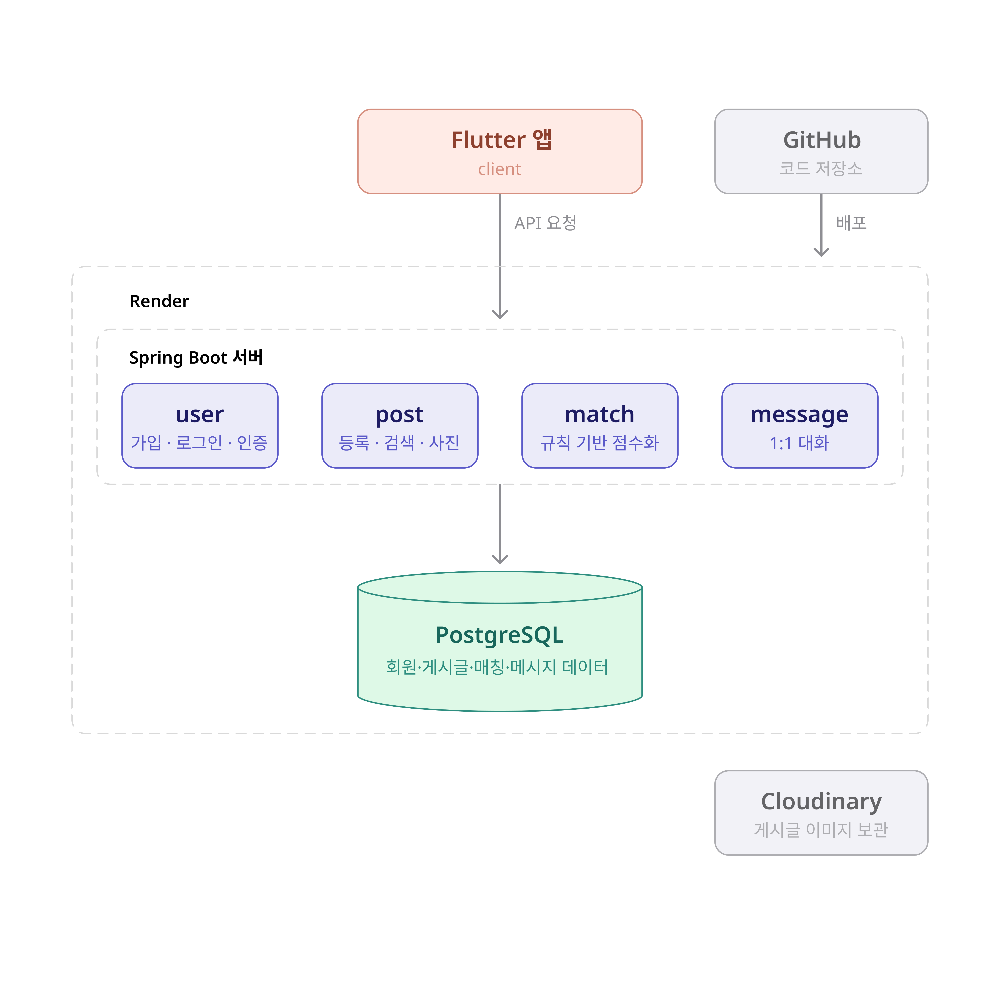

# 잇다

**분실물과 습득물을 연결하는 매칭 서비스**

분실물과 습득물 정보를 등록하고, 물건의 종류·장소·날짜·특징을 바탕으로 관련 게시글을 매칭하여 분실물을 찾고 주인에게 돌려줄 수 있도록 돕는 모바일 서비스입니다.

## 주요 기능

- **분실물·습득물 관리:** 물품 정보, 분실·습득 장소 및 날짜, 특징과 이미지 등록·수정·삭제
- **게시글 탐색:** 유형, 카테고리, 키워드, 장소, 날짜를 기준으로 검색 및 필터링
- **매칭 추천:** 게시글 정보를 바탕으로 분실물과 습득물 간의 일치 가능성 제공
- **채팅 기반 소유자 확인:** 매칭된 사용자 간 대화를 통한 소유자 확인 및 반환 방법 협의
- **반환 상태 관리:** 게시글 상태 관리 및 반환 완료된 게시글 간 연결
- **마이페이지:** 내가 등록한 게시글과 매칭·대화 내역 확인

## 기술 스택

| 구분 | 기술 |
| --- | --- |
| Frontend | Flutter, Dart |
| Backend | Java 21, Spring Boot |
| Database | PostgreSQL |
| Image Storage | Cloudinary |
| CI | GitHub Actions |
| Deployment | Render |
| Version Control | Git, GitHub |

## 시스템 구성



- Flutter 앱에서 Spring Boot REST API를 호출합니다.
- Spring Boot 서버에서 인증, 게시글, 검색, 매칭 및 채팅 관련 로직을 처리합니다.
- PostgreSQL에 사용자 및 서비스 데이터를 저장합니다.
- Cloudinary에 게시글 이미지를 저장하고, 데이터베이스에는 이미지 URL 등의 참조 정보를 저장합니다.
- GitHub Actions를 이용해 변경된 영역에 따라 백엔드 빌드·테스트 또는 프론트엔드 분석·테스트를 실행합니다.

## 프로젝트 구조

```text
ITDA/
├── .github/
│   └── workflows/
│       └── ci.yml      # GitHub Actions CI
├── frontend/           # Flutter 모바일 앱
├── backend/            # Spring Boot 서버
├── docs/               # 프로젝트 문서
├── .env.example        # 로컬 환경 변수 예시
├── docker-compose.yml  # 로컬 PostgreSQL 실행 설정
└── README.md           # 프로젝트 소개 및 실행 안내
```

## 프로젝트 문서

| 문서 | 설명 |
| --- | --- |
| [PRD](docs/PRD.md) | 서비스 요구사항 및 개발 범위 |
| [SCREEN](docs/SCREEN.md) | 화면 구성 및 사용자 흐름 |
| [ERD](docs/ERD.md) | 데이터베이스 설계 |
| [API](docs/API.md) | API 명세 |
| [MATCHING](docs/MATCHING.md) | 매칭 규칙 및 점수 산정 기준 |
| [TEAM](docs/TEAM.md) | 협업 원칙 및 작업 방식 |
| [FLUTTER SETUP](docs/FLUTTER_SETUP.md) | Windows 기준 Flutter 개발 환경 구성 및 Android 앱 실행 |

## 실행 방법

### 사전 준비

- Git
- Flutter SDK 및 Android SDK
- Java 21
- Docker Desktop

### Frontend

Android 에뮬레이터를 실행한 뒤 다음 명령어를 실행합니다.

```bash
cd frontend
flutter pub get
flutter run
```

Windows에서의 상세한 설치 및 설정 방법은 `FLUTTER_SETUP.md`를 참고하세요.

### Backend

#### 1. 환경 변수 파일 준비

프로젝트 루트에서 `.env.example` 파일을 복사해 `.env` 파일을 생성합니다.

**Windows (PowerShell)**

```powershell
Copy-Item .env.example .env
```

**macOS / Linux**

```bash
cp .env.example .env
```

생성된 `.env` 파일에 로컬 개발 환경에 필요한 값을 설정합니다. 실제 사용하는 환경 변수는 `.env.example`을 참고하세요.

#### 2. PostgreSQL 실행

프로젝트 루트에서 다음 명령어를 실행합니다.

```bash
docker compose up -d
```

컨테이너가 정상적으로 실행 중인지 확인합니다.

```bash
docker compose ps
```

#### 3. Spring Boot 실행

백엔드 디렉터리로 이동합니다.

```bash
cd backend
```

**Windows (PowerShell)**

```powershell
.\gradlew.bat bootRun
```

**macOS / Linux**

```bash
./gradlew bootRun
```

위 명령어는 Gradle Wrapper가 포함되어 있고, Spring Boot 실행 태스크가 설정되어 있다는 전제입니다. 실제 환경 변수 주입 및 애플리케이션 설정에 따라 추가 설정이 필요할 수 있습니다.

## 테스트

GitHub Actions에서 변경된 파일 경로를 기준으로 필요한 작업을 실행합니다.

- **Backend:** Gradle 빌드 및 테스트
- **Frontend:** Flutter 의존성 설치, 정적 분석, 테스트

백엔드 테스트에서는 Testcontainers를 이용해 테스트용 PostgreSQL 환경을 구성합니다.

### Backend 테스트

```bash
cd backend
./gradlew test
```

Windows에서는 다음 명령어를 사용합니다.

```powershell
cd backend
.\gradlew.bat test
```

테스트 실행을 위해 Docker가 실행 중이어야 합니다.

### Frontend 테스트

```bash
cd frontend
flutter analyze
flutter test
```

## 배포

Render를 이용한 백엔드 및 데이터베이스 배포를 계획하고 있습니다. 배포 후 주요 기능을 검증할 예정입니다.

## 개발 상태

- [x] Flutter 프로젝트 생성 및 Android 에뮬레이터 실행 확인
- [x] Spring Boot 프로젝트 생성
- [x] 로컬 PostgreSQL 실행 환경 구성
- [x] GitHub Actions CI 구성
- [ ] 핵심 기능 개발
- [ ] 프론트엔드·백엔드 연동
- [ ] Render 배포 및 기능 검증