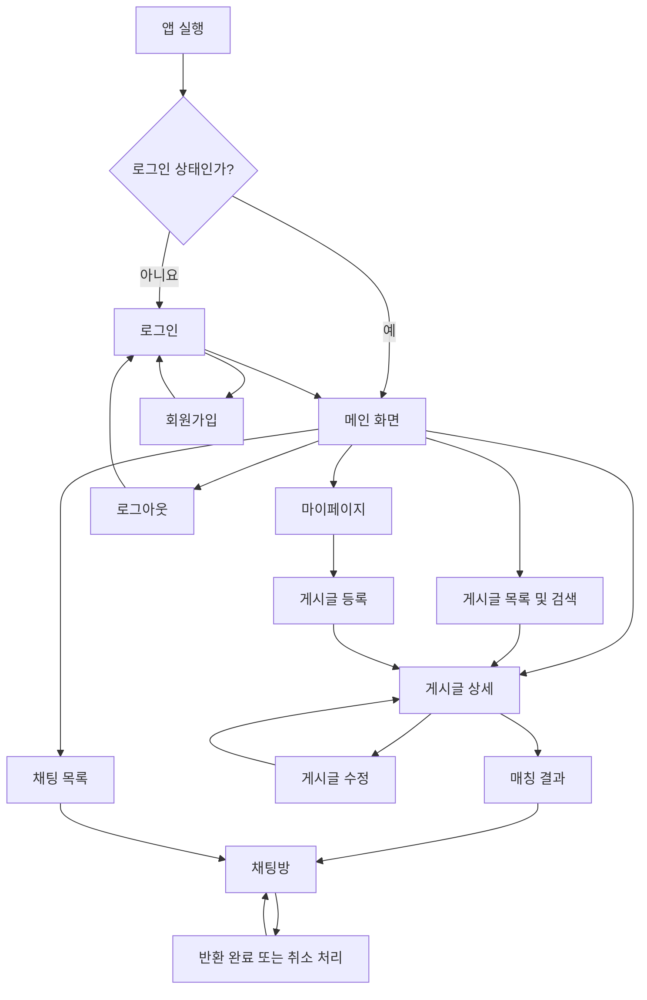

# 잇다 — 화면 설계

## 1. 설계 원칙

- 모바일 화면을 기준으로 설계한다.
- 회원가입과 로그인을 제외한 모든 서비스 기능은 로그인 사용자만 이용할 수 있다.
- 게시글 등록과 수정은 동일한 화면을 사용한다.
- 게시글 상태, 매칭 후보, 채팅방, 반환 기록을 서로 다른 개념으로 취급한다.
- 매칭 결과는 관련 게시글 추천이며, 실제 소유자 확인이나 반환 완료를 의미하지 않는다.
- 반환 완료 처리와 반환 기록 취소는 채팅방에서 진행한다.
- 지도, 실시간 GPS, AI 이미지 매칭, WebSocket, 읽음 표시, 푸시 알림, 신고·차단, 다중 이미지 첨부는 MVP 범위에서 제외한다.
- API 요청과 응답은 `API.md`, 데이터 구조는 `ERD.md`, 매칭 기준은 `MATCHING.md`를 참고한다.

---

## 2. 화면 목록

| ID | 화면 | 목적 | 접근 조건 |
|---|---|---|---|
| SCR-01 | 메인 화면 | 주요 기능 진입 및 게시글 탐색 | 로그인 필요 |
| SCR-02 | 게시글 목록 및 검색·필터 | 게시글 검색과 조건별 탐색 | 로그인 필요 |
| SCR-03 | 게시글 상세 | 게시글 정보 확인 및 관련 기능 이용 | 로그인 필요 |
| SCR-04 | 게시글 등록·수정 | 분실물·습득물 게시글 등록 및 수정 | 로그인 필요 |
| SCR-05 | 매칭 결과 | 관련 게시글 추천 결과 확인 | 로그인 필요 |
| SCR-06 | 채팅 목록 | 기존 대화 목록 확인 | 로그인 필요 |
| SCR-07 | 채팅방 | 메시지 교환 및 반환 처리 | 로그인 및 참여자 권한 확인 |
| SCR-08 | 회원가입 | 신규 계정 생성 | 비로그인 |
| SCR-09 | 로그인 | 사용자 인증 | 비로그인 |
| SCR-10 | 마이페이지 | 프로필, 본인 게시글, 관련 활동 확인 | 로그인 필요 |

별도의 프로필 상세 화면은 두지 않는다. 프로필과 본인 게시글은 마이페이지에서 확인한다. 프로필 수정은 별도 요구사항이 확정된 경우에만 추가한다.

---

## 3. 화면 간 이동 흐름

### 3.1 전체 흐름

반환 완료와 반환 기록 취소는 별도 화면이 아닌 채팅방 내 기능이다. 기존 채팅방이 있는 게시글 조합은 해당 채팅방을 재사용한다.

### 3.2 주요 사용자 흐름

**로그인 및 서비스 진입**

1. 앱 실행 시 로그인 상태를 확인한다.
2. 비로그인 상태라면 로그인 화면으로 이동한다.
3. 계정이 없다면 회원가입 후 인증 절차를 진행한다.
4. 로그인이 완료되면 메인 화면으로 이동한다.

**게시글 탐색 및 등록**

1. 메인 화면에서 분실물·습득물 게시글을 탐색한다.
2. 필요한 경우 목록 화면에서 검색하거나 필터를 적용한다.
3. 게시글을 선택해 상세 정보를 확인한다.
4. 게시글 등록은 메인 화면 또는 마이페이지에서 시작한다.
5. 등록이 완료되면 해당 게시글의 상세 화면으로 이동한다.

**매칭 및 채팅**

1. 게시글 상세 화면에서 매칭 결과를 확인한다.
2. 추천 게시글을 선택해 상세 정보를 확인한다.
3. 채팅을 시작하면 해당 게시글 조합의 기존 채팅방이 있는지 확인한다.
4. 기존 채팅방이 있으면 재사용하고, 없으면 새로 생성한다.
5. 대화에서 비공개 물건 특징 등을 확인하고 반환 방법을 협의한다.

**반환 완료 및 취소**

1. 실제 반환이 완료되면 습득자가 채팅방에서 반환 완료 처리를 진행한다.
2. 반환 기록이 생성되고 두 게시글의 상태가 변경된다.
3. 반환 완료된 분실물 게시글의 작성자는 처리 시점부터 7일 이내에 기존 채팅방에서 반환 기록을 취소할 수 있다.
4. 취소 후 게시글 상태는 복구되지만 기존 채팅방과 반환 기록은 유지된다.

---

## 4. 화면별 설계

### 4.1 SCR-01. 메인 화면

**목적**

주요 기능으로 진입하고 최근 분실물·습득물 게시글을 탐색한다.

**주요 UI 요소**

- 서비스명 및 상단 영역
- 검색 입력창
- 분실물·습득물 목록으로 이동하는 메뉴
- 최근 게시글 목록
- 게시글 등록 버튼
- 채팅 및 마이페이지 진입 메뉴
- 로그아웃 기능

**사용자 액션**

| 액션 | 처리 결과 |
|---|---|
| 검색어 입력 후 검색 | 검색어를 적용한 게시글 목록으로 이동 |
| 분실물 또는 습득물 선택 | 해당 유형을 적용한 게시글 목록으로 이동 |
| 게시글 선택 | 게시글 상세 화면으로 이동 |
| 게시글 등록 선택 | 게시글 등록 화면으로 이동 |
| 채팅 메뉴 선택 | 채팅 목록으로 이동 |
| 마이페이지 선택 | 마이페이지로 이동 |
| 로그아웃 선택 | 인증 정보 정리 후 로그인 화면으로 이동 |

게시글이 없으면 빈 목록 안내를 표시한다.

### 4.2 SCR-02. 게시글 목록 및 검색·필터 화면

**목적**

분실물·습득물 게시글을 검색하고 조건에 따라 결과를 좁힌다.

**주요 UI 요소**

- 검색어 입력창
- 게시글 유형 필터: 전체, 분실물, 습득물
- 카테고리 필터
- 물건명·키워드 검색
- 장소 및 날짜 필터
- 검색 결과 목록
- 필터 초기화 기능

**사용자 액션**

| 액션 | 처리 결과 |
|---|---|
| 검색 실행 | 검색 조건에 맞는 목록 표시 |
| 필터 선택 | 선택한 조건에 맞게 결과 갱신 |
| 필터 초기화 | 기본 검색 조건으로 복구 |
| 게시글 선택 | 해당 게시글 상세 화면으로 이동 |
| 뒤로 가기 | 이전 화면으로 복귀 |

찾음 또는 반환 완료 상태의 게시글도 일반 목록에서 조회할 수 있다. 단, 신규 매칭 후보에서는 제외한다.

### 4.3 SCR-03. 게시글 상세 화면

**목적**

게시글의 상세 정보를 확인하고 작성자 또는 일반 사용자에게 허용된 기능을 제공한다.

**주요 UI 요소**

- 게시글 유형 및 상태
- 물건명과 카테고리
- 분실·습득 날짜 및 장소
- 물건 특징과 설명
- 첨부 이미지
- 공개 가능한 작성자 정보
- 매칭 결과 확인 버튼
- 작성자 전용 수정·삭제 버튼
- 반환 완료 기록이 있는 경우 반환 상대 게시글 정보

**사용자 액션**

| 액션 | 처리 결과 |
|---|---|
| 매칭 결과 확인 | 매칭 결과 화면으로 이동 |
| 수정 선택 | 작성자 권한 확인 후 등록·수정 화면을 수정 모드로 열기 |
| 삭제 선택 | 삭제 가능 여부 확인 후 삭제 처리 |
| 반환 상대 게시글 선택 | 연결된 게시글 상세 화면으로 이동 |
| 뒤로 가기 | 이전 화면으로 복귀 |

**상태 및 권한 처리**

- 수정·삭제 기능은 작성자에게만 제공한다.
- 찾음 또는 반환 완료 상태에서는 신규 매칭으로 이어지는 기능을 제한한다.
- 반환 완료 상태에서는 반환 상대 게시글 정보를 표시한다.
- 반환 기록이 취소되면 현재 유효한 반환 완료 표시를 제거하고 복구된 게시글 상태를 표시한다.
- 게시글이 삭제되었거나 접근할 수 없는 경우 안내 후 이전 화면으로 돌아갈 수 있도록 한다.

관련 기록이 있는 게시글의 삭제 가능 여부와 삭제 후 기존 채팅·반환 기록의 표시 방식은 별도 정책에서 결정한다. 화면에서 임의로 삭제 정책을 확정하지 않는다.

### 4.4 SCR-04. 게시글 등록·수정 화면

**목적**

분실물 또는 습득물 게시글을 등록하거나 기존 게시글을 수정한다.

**화면 구성**

등록과 수정은 동일한 폼을 사용한다. 수정 모드에서는 기존 게시글 정보를 입력 필드에 표시한다.

**주요 UI 요소**

- 게시글 유형 선택: 분실물, 습득물
- 물건명 입력
- 카테고리 선택
- 날짜 및 장소 입력
- 물건 특징 입력
- 설명 입력
- 이미지 첨부 및 미리보기
- 등록 또는 수정 완료 버튼
- 취소 버튼

**사용자 액션**

| 액션 | 처리 결과 |
|---|---|
| 게시글 유형 선택 | 해당 유형의 입력 안내 표시 |
| 이미지 첨부 | 이미지 미리보기 표시 |
| 이미지 제거 | 첨부 이미지 제거 |
| 등록 완료 | 입력값 검증 후 게시글 생성, 상세 화면으로 이동 |
| 수정 완료 | 입력값 검증 후 변경 사항 저장, 상세 화면으로 이동 |
| 취소 | 저장하지 않고 이전 화면으로 복귀 |

**입력 및 권한 규칙**

- 필수 입력값이 누락되면 해당 항목에 오류를 표시한다.
- 이미지는 선택 사항이며 최대 1장만 첨부한다.
- 이미지 업로드 실패 시 안내와 재시도 기능을 제공한다.
- 본인 게시글이 아니거나 수정할 수 없는 상태라면 수정 요청을 제한한다.
- 찾음 또는 반환 완료 상태 게시글의 수정 가능 범위는 PRD의 게시글 정책을 따른다.

### 4.5 SCR-05. 매칭 결과 화면

**목적**

현재 게시글과 관련성이 높은 반대 유형의 게시글을 확인한다.

**주요 UI 요소**

- 기준 게시글 정보
- 추천 게시글 목록
- 추천 점수 또는 매칭 근거 요약
- 추천 게시글 상세 화면으로 이동하는 항목
- 채팅 시작 버튼
- 추천 결과가 없을 때의 안내

**매칭 후보 표시 원칙**

- 분실물은 습득물과, 습득물은 분실물과 매칭한다.
- 카테고리, 장소의 근접성, 날짜 차이, 특징 키워드 유사도를 활용한다.
- 본인 게시글과 찾음·반환 완료 상태의 게시글은 신규 후보에서 제외한다.
- 반환 기록 취소로 상태가 복구된 게시글은 다시 매칭 후보가 될 수 있다.
- 매칭 점수 및 계산 방식은 `MATCHING.md`를 따른다.

**사용자 액션**

| 액션 | 처리 결과 |
|---|---|
| 추천 게시글 선택 | 해당 게시글 상세 화면으로 이동 |
| 채팅 시작 선택 | 기존 채팅방이 있으면 이동하고, 없으면 생성 후 이동 |
| 기준 게시글 상세로 이동 | 기준 게시글 상세 화면으로 이동 |
| 뒤로 가기 | 이전 화면으로 복귀 |

추천 결과는 실제 소유자 확인이나 반환 완료를 보장하지 않는다. 채팅 시작 시 게시글의 최신 상태와 채팅방 존재 여부를 확인하며, 더 이상 매칭할 수 없는 게시글은 진행을 제한한다. 동일한 분실물·습득물 게시글 조합에는 채팅방을 중복 생성하지 않는다.

### 4.6 SCR-06. 채팅 목록 화면

**목적**

사용자가 참여 중인 기존 채팅방을 확인하고 대화를 이어간다.

**주요 UI 요소**

- 채팅방 목록
- 상대방 식별 정보
- 연결된 게시글 정보
- 최근 메시지 내용 일부
- 마지막 메시지 시각

**사용자 액션**

| 액션 | 처리 결과 |
|---|---|
| 채팅방 선택 | 해당 채팅방으로 이동 |
| 뒤로 가기 | 이전 화면으로 복귀 |

참여 중인 채팅방이 없으면 빈 목록 안내를 표시한다. 반환 완료 또는 반환 기록 취소 이후에도 기존 채팅방과 대화 내역은 유지한다.

### 4.7 SCR-07. 채팅방 화면

**목적**

매칭된 분실물·습득물 게시글의 당사자가 대화하고, 실제 반환 여부를 확인하거나 반환 처리를 진행한다.

**주요 UI 요소**

- 상대방 정보
- 연결된 분실물·습득물 게시글 요약
- 메시지 목록
- 메시지 입력창 및 전송 버튼
- 연결된 게시글 상세 화면으로 이동하는 기능
- 반환 완료 관련 안내 및 처리 기능
- 조건 충족 시 반환 기록 취소 기능

**채팅 기본 동작**

- 채팅 참여자만 해당 채팅방과 메시지를 조회하거나 메시지를 전송할 수 있다.
- 메시지는 저장 후 대화 내역에 표시하며, 기존 메시지를 조회할 수 있다.
- 비공개 물건 특징 등을 활용해 소유 여부를 확인하고 반환 방법을 협의할 수 있다.
- MVP에서는 기본적인 메시지 송수신과 내역 조회를 구현한다.
- WebSocket, 읽음 표시, 푸시 알림은 MVP 필수 범위에서 제외한다.

**사용자 액션**

| 액션 | 처리 결과 |
|---|---|
| 메시지 전송 | 메시지를 저장하고 대화 내역에 표시 |
| 연결 게시글 선택 | 연결된 게시글 상세 화면으로 이동 |
| 반환 완료 처리 | 권한과 상태 검증 후 반환 기록 생성 및 게시글 상태 변경 |
| 반환 기록 취소 | 권한과 기한 검증 후 반환 기록 취소 및 게시글 상태 복구 |
| 뒤로 가기 | 채팅 목록 또는 이전 화면으로 복귀 |

반환 완료와 취소의 권한, 처리 절차, 상태 변경 및 예외 규칙은 **7장**을 따른다. 화면에서는 처리 대상과 결과를 확인할 수 있도록 한다.

### 4.8 SCR-08. 회원가입 화면

**목적**

신규 사용자가 잇다 계정을 생성한다.

**주요 UI 요소**

- 이메일 입력
- 비밀번호 입력
- 닉네임 입력
- 회원가입 버튼
- 로그인 화면 이동 링크

**사용자 액션**

| 액션 | 처리 결과 |
|---|---|
| 회원가입 버튼 선택 | 필수값 검증 후 계정 생성 요청 |
| 회원가입 성공 | 인증 설계에 따른 다음 화면으로 이동 |
| 로그인 링크 선택 | 로그인 화면으로 이동 |

**예외 처리**

- 비로그인 사용자도 접근할 수 있다.
- 필수값 누락 및 입력 형식 오류를 안내한다.
- 이메일 중복 등 계정 생성 실패 사유를 안내한다.
- 서버 오류 발생 시 재시도할 수 있도록 한다.
- 로그인 사용자가 접근하면 메인 화면으로 이동하거나 접근을 제한한다.

회원가입 후 자동 로그인 여부와 성공 후 이동 화면은 인증 설계에서 확정한다.

### 4.9 SCR-09. 로그인 화면

**목적**

기존 사용자의 인증을 처리한다.

**주요 UI 요소**

- 이메일 입력
- 비밀번호 입력
- 로그인 버튼
- 회원가입 화면 이동 링크

**사용자 액션**

| 액션 | 처리 결과 |
|---|---|
| 로그인 버튼 선택 | 입력값 검증 후 로그인 요청 |
| 로그인 성공 | 메인 화면으로 이동 |
| 회원가입 링크 선택 | 회원가입 화면으로 이동 |

**예외 처리**

- 비로그인 사용자도 접근할 수 있다.
- 필수값 누락 및 입력 형식 오류를 안내한다.
- 인증 실패 시 로그인 정보를 다시 입력할 수 있도록 한다.
- 서버 오류 발생 시 재시도할 수 있도록 한다.
- 로그인 사용자가 접근하면 메인 화면으로 이동하거나 접근을 제한한다.

로그아웃은 마이페이지에서 제공한다.

### 4.10 SCR-10. 마이페이지

**목적**

사용자의 기본 프로필, 본인 게시글 및 관련 활동을 확인하고 계정 기능을 이용한다.

**주요 UI 요소**

- 닉네임 및 이메일
- 본인이 작성한 게시글 목록 및 상태
- 참여 중인 매칭·채팅 관련 항목
- 반환 완료된 게시글 및 반환 상대 정보
- 게시글 등록 버튼
- 로그아웃 버튼

**사용자 액션**

| 액션 | 처리 결과 |
|---|---|
| 본인 게시글 선택 | 해당 게시글 상세 화면으로 이동 |
| 매칭·채팅 항목 선택 | 관련 매칭 결과 또는 채팅방으로 이동 |
| 게시글 등록 선택 | 게시글 등록 화면으로 이동 |
| 로그아웃 선택 | 인증 정보 정리 후 로그인 화면으로 이동 |

게시글이 없으면 빈 목록 안내와 등록 기능을 표시한다. 프로필 또는 게시글 조회에 실패하면 오류 안내와 재시도 기능을 제공한다. 프로필 수정은 별도 요구사항이 확정된 경우에만 추가한다.

---

## 5. 공통 화면 동작 및 접근 제어

### 5.1 로그인 여부에 따른 접근

| 기능 | 비로그인 사용자 | 로그인 사용자 |
|---|---|---|
| 메인 화면 및 게시글 조회 | 로그인 필요 | 가능 |
| 게시글 등록·수정·삭제 | 로그인 필요 | 권한 및 상태에 따라 가능 |
| 매칭 결과 조회 | 로그인 필요 | 가능 |
| 채팅 목록 조회 | 로그인 필요 | 가능 |
| 채팅방 접근 및 메시지 송수신 | 로그인 필요 | 참여자 권한 확인 후 가능 |
| 반환 완료 처리 | 로그인 필요 | 습득자 권한 및 상태 확인 후 가능 |
| 반환 기록 취소 | 로그인 필요 | 분실물 작성자 권한 및 기한 확인 후 가능 |
| 마이페이지 | 로그인 필요 | 가능 |
| 회원가입 및 로그인 | 가능 | 메인 화면으로 이동하거나 접근 제한 |

회원가입과 로그인을 제외한 모든 서비스 기능은 로그인 사용자만 이용할 수 있다. 비로그인 사용자가 보호된 화면이나 기능에 접근하면 로그인 화면으로 안내한다.

MVP에서는 로그인 성공 후 메인 화면으로 이동하는 방식을 기본으로 한다.

### 5.2 인증 및 권한 검증

- 앱 진입 및 보호된 화면 접근 시 로그인 상태를 확인한다.
- 인증 만료 또는 인증 정보가 유효하지 않으면 인증 정보를 정리하고 로그인 화면으로 이동한다.
- 로그아웃 후 뒤로 가기 등으로 보호된 화면에 다시 접근하지 못하도록 처리한다.
- 화면에서 버튼을 숨기는 것만으로 권한을 보장하지 않는다. 실제 인증 및 인가 검증은 서버에서 수행한다.
- 게시글 수정·삭제는 작성자 권한을 확인한다.
- 채팅방과 메시지는 참여자 권한을 확인한다.
- 반환 완료 및 취소 요청은 각 처리 주체의 권한과 게시글 상태를 서버에서 검증한다.

### 5.3 매칭 후보와 채팅방의 관계

- 매칭 후보는 관련 게시글을 추천하는 결과다.
- 동일한 분실물·습득물 게시글 조합에는 채팅방을 중복 생성하지 않는다.
- 게시글 상태가 변경되거나 매칭 후보에서 제외되어도 기존 채팅과 반환 기록을 임의로 삭제하지 않는다.
- 반환 기록 취소 후 게시글이 다시 매칭 후보가 되면 기존 채팅방을 재사용한다.
- 별도의 매칭 후보 진행 상태나 채팅방별 업무 상태는 관리하지 않는다.

---

## 6. 공통 예외 처리

모든 화면은 정상 흐름뿐 아니라 로딩, 데이터 없음, 요청 실패 및 권한 오류를 처리한다.

| 상황 | 화면 동작 |
|---|---|
| 최초 데이터 조회 중 | 로딩 표시 |
| 목록에 데이터가 없음 | 빈 목록 안내 및 가능한 다음 행동 표시 |
| 검색 결과가 없음 | 조건에 맞는 결과가 없다는 안내 |
| 서버 요청 실패 | 오류 안내 및 재시도 제공 |
| 필수 입력값 누락 | 해당 입력 항목에 오류 표시 |
| 이미지 업로드 실패 | 실패 안내 및 재시도 제공 |
| 비로그인 상태에서 보호된 기능 접근 | 로그인 화면으로 안내 |
| 로그인 상태에서 로그인·회원가입 화면 접근 | 메인 화면으로 이동하거나 접근 제한 |
| 인증 만료 또는 인증 정보 무효 | 인증 정보를 정리하고 로그인 화면으로 안내 |
| 게시글 수정·삭제 권한 없음 | 권한 없음 안내 |
| 채팅방 참여 권한 없음 | 접근 차단 및 안내 |
| 게시글이 삭제되었거나 조회 불가 | 조회 불가 안내 및 이전 화면 복귀 |
| 매칭 후보의 상태가 변경됨 | 최신 상태 확인 후 진행 불가 안내 |
| 반환 완료 또는 취소 처리 실패 | 최신 상태를 다시 조회하고 결과 안내 |
| 반환 취소 기한 만료 | 취소 불가 안내 |
| 메시지 전송 실패 | 전송 실패 안내 및 재시도 제공 |

서버에서 반환된 오류 내용은 사용자에게 필요한 수준으로 안내한다. 내부 오류 메시지, 인증 정보 및 민감한 시스템 정보를 그대로 노출하지 않는다.

---

## 7. 반환 완료 및 반환 기록 취소

### 7.1 게시글 상태별 표시

| 게시글 유형 | 반환 전 상태 | 반환 완료 상태 |
|---|---|---|
| 분실물 | 찾는 중 | 찾음 |
| 습득물 | 보관 중 | 반환 완료 |

반환 완료 상태의 게시글은 일반 목록에서 조회할 수 있지만 신규 매칭 후보에서는 제외한다.

### 7.2 반환 완료 처리

1. 실제 반환을 수행한 습득자가 반환 여부를 확인한다.
2. 습득자가 채팅방에서 반환 완료 처리를 요청한다.
3. 서버에서 처리 권한과 게시글 상태를 검증한다.
4. 반환 기록을 생성한다.
5. 분실물 게시글은 `찾음`, 습득물 게시글은 `반환 완료`로 변경한다.
6. 두 게시글에 서로의 반환 상대 게시글 정보를 표시한다.
7. 기존 채팅방과 메시지는 유지한다.

이미 반환 완료된 조합에 대해 중복으로 반환 기록이 생성되지 않도록 한다. 반환 완료 처리는 매칭 추천이나 채팅 시작과 별개로 수행한다.

### 7.3 반환 기록 취소

1. 반환 완료된 분실물 게시글의 작성자가 기존 채팅방에서 반환 기록과 취소 가능 여부를 확인한다.
2. 취소 가능 기간은 반환 완료 처리 시점부터 7일 이내다.
3. 사용자가 취소를 확인하면 서버에서 작성자 권한, 반환 기록 상태 및 기한을 검증한다.
4. 반환 기록을 삭제하지 않고 취소 상태로 변경한다.
5. 분실물 게시글은 `찾는 중`, 습득물 게시글은 `보관 중`으로 복구한다.
6. 두 게시글의 연결 정보와 기존 채팅 내역을 유지한다.

7일이 지난 경우 일반적인 반환 취소 기능을 제공하지 않는다. 기간이 지난 기록의 예외 처리나 관리자 개입 기능은 MVP 범위에 포함하지 않는다.

### 7.4 취소 이후 화면 동작

- 취소된 반환 기록은 현재 유효한 반환 완료 기록으로 표시하지 않는다.
- 두 게시글은 복구된 상태에 따라 다시 매칭 후보가 될 수 있다.
- 기존 채팅방과 메시지는 유지하며, 동일한 게시글 조합으로 채팅을 시작하면 기존 채팅방을 재사용한다.
- 취소 가능 여부는 클라이언트 시간만으로 판단하지 않고 서버의 검증 결과를 따른다.
- 기한 만료 또는 처리 실패 시 최신 서버 상태를 기준으로 안내한다.

---

## 8. 미결정 사항 및 후속 결정

아래 항목은 기존 요구사항만으로 구체적인 UI 동작을 확정하기 어려운 사항이다. 결정 결과는 관련 문서에도 반영한다.

### 8.1 기능 동작 관련

- **회원가입 후 이동:** 자동 로그인 후 메인 화면으로 이동할지, 로그인 화면으로 이동할지
- **완료 상태 게시글의 수정·삭제:** 관련 기록이 있는 게시글의 수정·삭제 가능 범위와 삭제 후 기존 기록의 표시 방식

### 8.2 UI 세부 사항

- 검색 조건 저장 및 최근 검색어 표시 여부
- 채팅 목록 정렬 기준과 최근 메시지 요약 표시 여부
- 빈 목록 및 오류 화면의 구체적인 문구와 시각적 스타일
- 매칭 추천 근거를 표시하는 구체적인 UI 형태
- 프로필 수정 기능의 추가 여부

인증·인가, API, 데이터 구조 및 매칭 정책의 세부 사항은 각각 담당 문서에서 관리한다. 이 문서에서는 화면 구성과 사용자 이동에 필요한 내용만 다룬다.